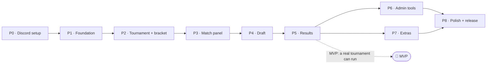

# Implementation Plan

Builds the system described in [SYSTEM_DESIGN.md](SYSTEM_DESIGN.md). Each phase
ends with a demo on a test server and your sign-off before the next one starts.

**Definition of done (every phase):** `pytest` green · `ruff check` clean ·
manual checklist ticked on the test server · docs updated · committed + pushed.

**Dev mode** (`dev_mode: true` in config, added in P1): allows fake player IDs
that aren't server members, lets admins act for any player, and shortens all
timers, so one person with two accounts can test a whole tournament.

## Status (handover)

All phases P1–P8 are implemented on branch `ccr-d33f10a4-hir0z0`. Verified without Discord:

| Area | How it was verified |
|---|---|
| Rules: formats, bracket and byes (2–128 players), draft order, legality, Fearless, series, ELO, CSV, roster | Unit tests, including 1,000 random drafts that never produce an illegal pick |
| Services: full tournaments (2, 4, 7, 128 players), rematch vs next game, disputes, timeouts, no-shows, DQ/forfeits, swaps, cancel, stats | Flow tests with a fake clock |
| Restart safety | Timers that were due while offline restart with full time; the turn deadline follows the restarted timer |
| Rendering | Board in every state + bracket at 7 and 128 players, checked by eye against the approved mockups |
| Discord layer | Whole tournaments driven through the real notifier and button handlers with fake Discord objects; every slash command payload validated offline |
| Packaging | Fresh clone → install → `init` → `check` → `preview` → test suite |

Still needs the live server (your token and IDs): run P0, then the manual checks below on a test
server. Dev mode lets one admin play both sides of a match.

---

## P0 · Discord setup (you, ~15 min)

- [ ] Create a test server, plus an application and bot in the Discord Developer Portal
- [ ] Enable the **Message Content** intent and copy the bot token
- [ ] Invite the bot with: View Channels, Send Messages, Send in Threads, Create Private Threads, Manage Threads, Embed Links, Attach Files, Read History, Mention roles
- [ ] Create `#admin`, `#announce`, `#matches`, `#live-draft` and a `Tournament Admin` role, then copy their IDs

**Validate:** the bot shows up in the member list (it goes online in P1).

## P1 · Foundation

- [ ] 1.1 `pyproject.toml`: discord.py 2.6, Pillow, SQLAlchemy 2 + aiosqlite, pydantic-settings, PyYAML. Dev: pytest, pytest-asyncio, ruff
- [ ] 1.2 Config: `.env` (token, guild ID) + `config.yaml` (channel/role IDs, timers, draft order, dev_mode), validated at startup with readable errors
- [ ] 1.3 Entry point `python -m aniimo_pvp`, guild-scoped command sync, logs to console + `logs/bot.log`
- [ ] 1.4 DB models (design §7), tables created on startup, repository helpers
- [ ] 1.5 Roster loader + validation (unique slug, known element, image present) + placeholder thumbnail generator
- [ ] 1.6 App-emoji sync with content-hash cache · `/roster reload`
- [ ] 1.7 CSV player parser (pure) + `#admin` listener + `/tournament players file:` + preview embed with Confirm / Cancel
- [ ] 1.8 Dev mode switches

**Validate**
- `pytest tests/test_roster.py tests/test_csv_import.py`
  - roster: valid file · duplicate slug · unknown element · missing image → placeholder
  - CSV: with/without header · extra spaces · blank lines · duplicate ID or UID · non-numeric ID · non-member (rejected unless dev mode)
- Manual: bot online · `/roster reload` reports *N Aniimo, N emojis* · the emojis appear in Dev Portal → Emojis · paste a CSV with 1 bad row → preview shows that row's error · Confirm → players saved

## P2 · Tournament + bracket

- [ ] 2.1 `domain/bracket.py`: shuffle (`secrets`, seed logged), size 2^k, standard seed positions, byes, next-match links, advancement · `domain/formats.py`: Quick / Standard / Championship, Bo per round counted from the final
- [ ] 2.2 `/tournament create name` → step 1 panel (player cap 8–128, format, Fearless, live round preview) → **Next: add players** → step 2 CSV · `/tournament start · status · cancel` with status guards; cap/format locked after start
- [ ] 2.3 `render/bracket.py`: bracket image (byes, winners highlighted) + text table fallback
- [ ] 2.4 `#announce` post: image + Round 1 table with mentions
- [ ] 2.5 One private thread per match (not invitable), players + admin role added, UID card. Bye matches auto-resolve with no thread

**Validate**
- Unit: format table matches design §3.4 (Bo per round and max games for every cap) · CSV over the cap rejected
- Unit, for N = 2…128: bracket size correct · byes = size − N · no bye-vs-bye · every player exactly once · same seed gives the same bracket · winners fill the correct next slot
- Render: bracket PNG for N = 5, 8, 13 written to `tests/output/` → check by eye
- Manual (dev mode, 2 real + 4 fake): start → image + table in `#announce` · 2 byes advanced · threads created · a non-player can't see the private threads

## P3 · Match panel

- [ ] 3.1 `domain/match.py`: state machine from design §4, illegal transitions raise
- [ ] 3.2 Scheduler: `JOB` table, asyncio loop, cancel/reschedule, restart rule (overdue → full duration again)
- [ ] 3.3 Control panel view with persistent `DynamicItem` buttons, re-rendered on every state change
- [ ] 3.4 Ready check · no-show jobs (reminder at 10 min, escalation at 15 min) · admin buttons Give win / Extend / DQ both
- [ ] 3.5 Coin flip + side choice (2 min → Side A) · G2+ the loser chooses
- [ ] 3.6 🆘 Call admin

**Validate**
- Unit: every allowed transition passes and every other one raises · side-chooser rule for G1 vs G2+ · scheduler with a fake clock fires in order and restarts overdue jobs
- Manual (timers set to 1–2 min): ready flow with 2 accounts · a non-player's click is rejected · no-show reaches the admin buttons · restart the bot while waiting → buttons still work

## P4 · Draft

- [ ] 4.1 `domain/draft.py`: order from config, current step, legal set, apply, timeout action, undo, Fearless hook
- [ ] 4.2 Private picker: element menu → Aniimo menu (emoji icons, legal only, pages if more than 25) → 🔒 Lock in · 🔍 search modal (fuzzy name match)
- [ ] 4.3 Turn message + 🎯 button · `<t:…:R>` countdown · `draft_step` job (45 s)
- [ ] 4.4 `render/board.py` (design §5.3)
- [ ] 4.5 Per-match lock + step ID in custom IDs, so stale or double clicks are ignored

**Validate**
- Unit: the 12-step order matches the spec · rejected: banned, already picked, out of turn, stale step · timeout gives skip (ban) or a legal random pick · undo restores the exact previous state · 1,000 random full drafts never produce an illegal pick
- Render: board PNG for empty, mid-draft (step 7) and complete drafts, plus one with missing thumbnails
- Manual: a full draft on PC **and** phone · opponent clicks 🎯 → "not your turn" · let one step time out → tagged auto · double-click Lock in → one action · searching "emb" finds Embertail · board updates within 2 s of Lock in

## P5 · Results + progression (🏁 MVP)

- [ ] 5.1 `domain/series.py`: BoN scoring from `confirmed` games only, wins needed = ⌈Bo/2⌉, Bo per match from the format, `can_next_game()` (false for Bo1 or a decided series)
- [ ] 5.2 🏆 Report (winner buttons, optional screenshot) → ✅ Confirm / ⚠️ Dispute · `auto_confirm` job
- [ ] 5.3 🔁 Rematch (design §4.1): only while `Playing`, opponent accepts · `rematch_offer` job · voids the current attempt and creates the same `number` with `attempt + 1`. Same teams copies the draft (`draft_source_id`) · new draft restarts at step 1
- [ ] 5.4 ▶ Next game (Bo3/Bo5 only): creates `number + 1`, `attempt 1` → side choice by the loser · button never rendered in Bo1
- [ ] 5.5 Match done: advance winner, archive thread, detect round complete → updated bracket + **▶ Start Round N** (admins only)
- [ ] 5.6 Final → champion post

**Validate**
- Unit: Bo1/Bo3/Bo5 detection (1-0, 2-0, 2-1, 3-2) · no game after the series is decided · rematch doesn't change the score
- Unit, rematch vs next game: a rematch keeps `number` and bumps `attempt` · the old attempt is `voided` and excluded from score, ELO, Fearless and stats · same-teams rematch copies all 12 draft actions · `can_next_game()` is false in Bo1, false once a player has the wins needed, and false before the last game is confirmed · the DB rejects a duplicate `(match, number, attempt)` · the example in design §4.1 reproduces score 2–1
- Manual end-to-end (dev mode, 4 players, Bo3): play to a champion, including 1 dispute, 1 rematch of each type, 1 auto-confirm · a non-admin can't click Start Round 2
- Manual Bo1 run: a confirmed game ends the match directly, and the panel never shows Next game

## P6 · Admin tools

- [ ] 6.1 `/admin undo · pause · resume · set-result · replay · dq · swap · extend`
- [ ] 6.2 Admin-role check on every admin command and button
- [ ] 6.3 Audit log row + echo message in the match thread for every admin action

**Validate**
- Unit: undo at step 0 raises an error · set-result recomputes the series and advancement · DQ mid-series advances the opponent · swap is blocked once the player has played
- Manual: each command once · a non-admin gets "admin only" · the audit log lists every action

## P7 · Extras

- [ ] 7.1 Live feed: one message per match in `#live-draft`, edited each step
- [ ] 7.2 Fearless toggle wired into the legal set · the picker notes "used in G1"
- [ ] 7.3 Stats: `/stats aniimo`, `/stats player`, summary posted after the final
- [ ] 7.4 ELO (start 1000, K=32) on match completion · `/leaderboard`, `/profile`

**Validate**
- Unit: Fearless blocks only your own earlier picks and bans reset each game · ELO: equal ratings → winner +16 and the total is conserved · stats on a fixture DB match the expected numbers
- Manual: watch the live feed during a draft · a Bo3 Fearless series · leaderboard after the test tournament

## P8 · Polish + release

- [ ] 8.1 README: Discord setup, invite URL, config, roster/thumbnail guide
- [ ] 8.2 Template `roster.csv` + `run.bat` / `run.sh`
- [ ] 8.3 DB backup on startup (keep the last 10) · friendly error messages
- [ ] 8.4 GitHub Actions: ruff + pytest
- [ ] 8.5 Pace thread creation to stay under Discord rate limits

**Validate**
- Fresh clone + README only → a running bot in ≤ 15 min
- Kill the bot mid-draft, mid-confirm and mid-no-show → after restart all three resume correctly
- 32-player dev tournament: all Round 1 threads created with no rate-limit errors
- CI green on the branch
