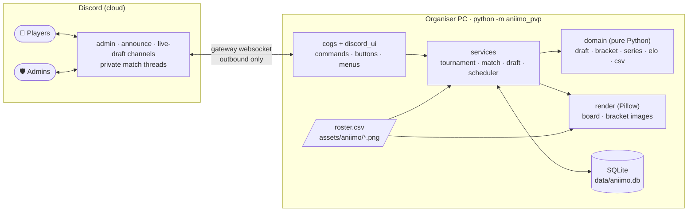
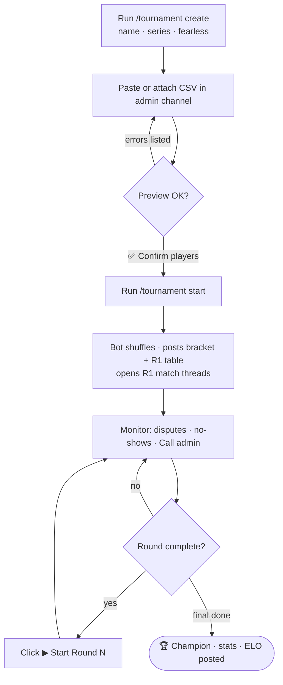
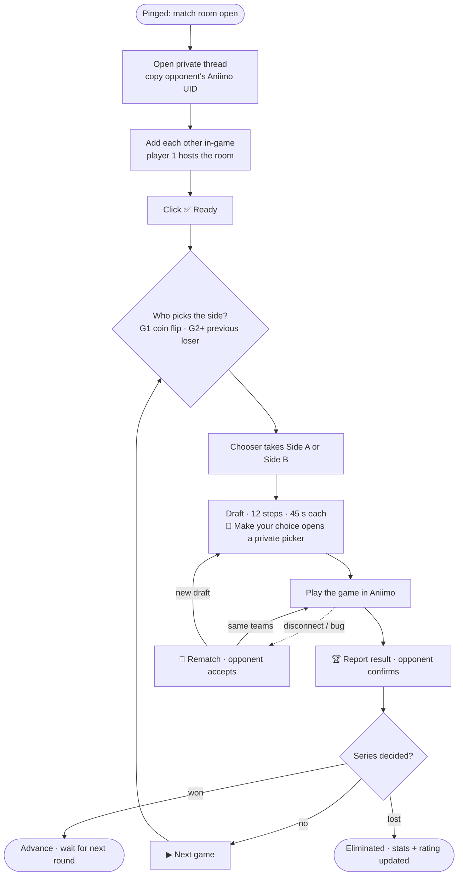
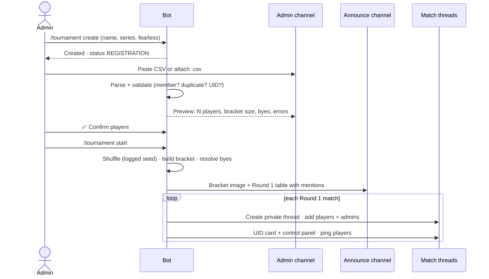
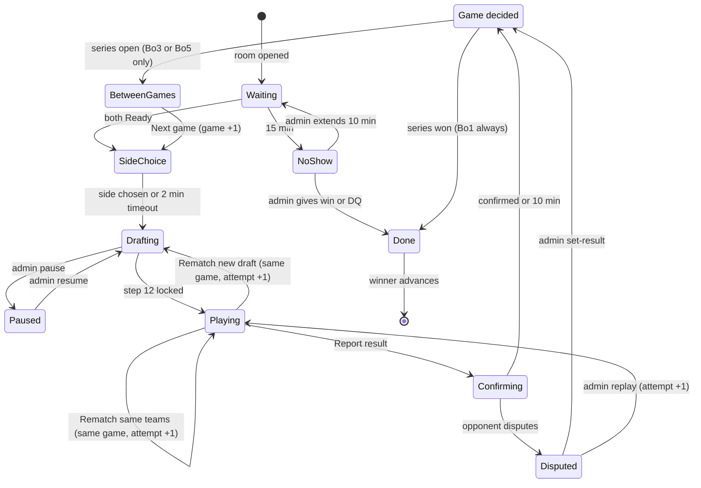
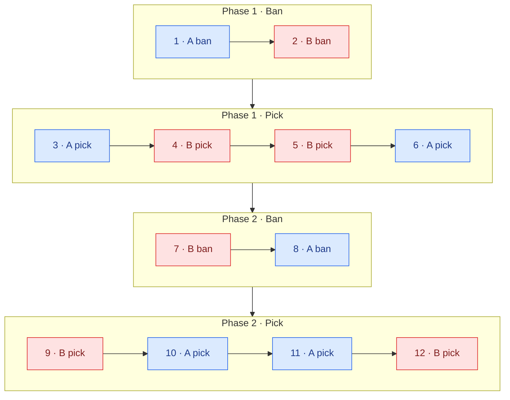
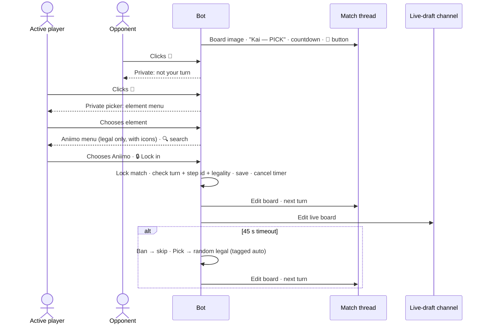
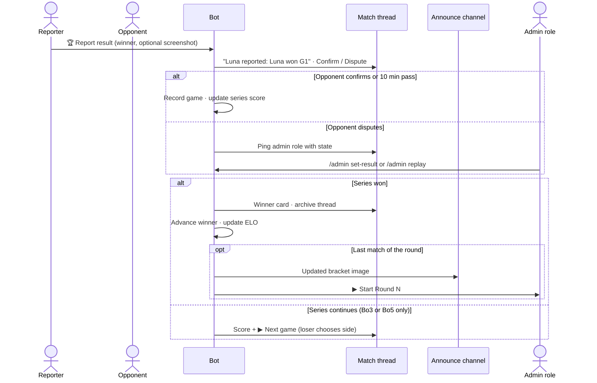
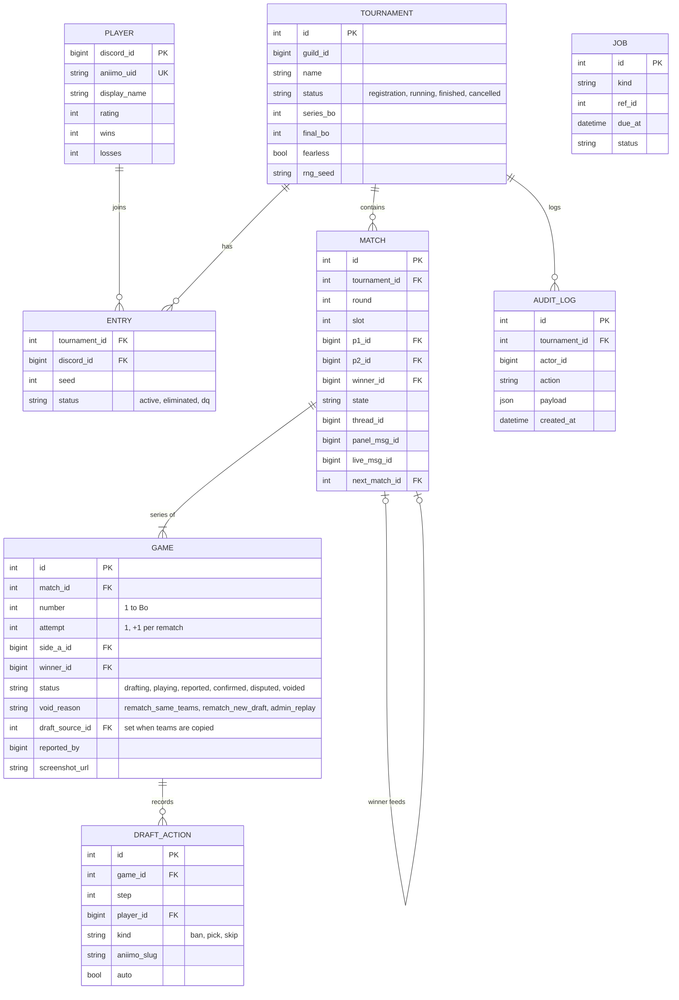

# System Design — Aniimo 1v1 Draft Tournament Bot

A Discord-only bot, written in Python and run on the organiser's PC, that runs
single-elimination Aniimo 1v1 tournaments with a ban/pick draft. Players never
leave Discord. The visual part is a draft-board image rendered with real Aniimo
thumbnails.

## 1. Decisions

| Area | Decision |
|---|---|
| Interface | Discord only: slash commands, embeds, buttons, select menus, rendered PNGs |
| Hosting | Organiser's PC, Python 3.11+. Outbound gateway connection only, so no public URL |
| Bracket | Single elimination, random shuffle, byes spread so no bye meets a bye |
| Series | Bo1 / Bo3 / Bo5 per tournament (optional different final) |
| Draft | 2 bans + 4 picks per player, two-phase split order, exclusive picks |
| Side choice | G1 coin flip, then winner chooses · G2+ previous game's loser chooses |
| Timer | 45 s/step; timeout → ban skipped, pick random |
| Match room | Private thread per match in `#matches` |
| Results | Report → opponent confirms/disputes → auto-confirm after 10 min |
| No-show | Reminder at 10 min, admin decides at 15 min |
| Next round | Admin clicks **▶ Start Round N** |
| Extras | Live draft feed, pick/ban stats, Fearless toggle, ELO leaderboard |

## 2. Architecture



| Layer | Responsibility | Discord-aware? |
|---|---|---|
| `cogs/`, `discord_ui/` | Commands, views, permission checks, message edits | yes |
| `services/` | Orchestrate a use case: load state → call domain → persist → notify | via interfaces |
| `domain/` | Rules: draft order and legality, bracket and byes, series scoring, Fearless, ELO, CSV parsing | no, unit-tested |
| `render/` | Board and bracket PNGs, placeholder thumbnails | no |
| `db/` | SQLAlchemy models + repository | no |

## 3. User flows

### 3.1 Admin



### 3.2 Player



### 3.3 Registration → Round 1



## 4. Match lifecycle

One **control panel** message per match; its buttons always match the current state.



| State | Panel buttons | Who can click |
|---|---|---|
| Waiting | ✅ Ready · 🆘 Call admin | both players |
| SideChoice | Side A (first pick) · Side B (counter-pick) | chooser |
| Drafting | 🎯 Make your choice | active player (others get a private "not your turn") |
| Playing | 🏆 Report result · 🔁 Rematch · 🆘 Call admin | both players |
| Confirming | ✅ Confirm · ⚠️ Dispute | opponent of reporter |
| BetweenGames (Bo3/Bo5 only) | ▶ Next game · 🆘 Call admin | both players |
| NoShow / Disputed | Give win to X · Extend · DQ both / set-result | admin role |

### 4.1 Rematch vs Next game

The two buttons are separate actions and write different rows, so the series
score can always be recomputed from the database.

| | 🔁 Rematch | ▶ Next game |
|---|---|---|
| Meaning | Replay the **current** game (disconnect, bug) | Start the **next** game of the series |
| `GAME` row | Same `number`, `attempt + 1`; the old attempt becomes `voided` | `number + 1`, `attempt = 1` |
| Draft | Same teams → copied (`draft_source_id`) · New draft → restarts at step 1 | Fresh draft |
| Score | Unchanged | Unchanged until this game is confirmed |
| When | While `Playing` (before a result is reported); opponent accepts or admin forces | After the previous game is `confirmed` and nobody has the wins needed |
| Series length | Bo1, Bo3, Bo5 | **Bo3 and Bo5 only**, never in Bo1 |
| Side | Same sides as the voided attempt | Loser of the previous confirmed game chooses |

Example, Bo3, with one rematch:

| Game | Attempt | Status | Winner | Draft | Score |
|---|---|---|---|---|---|
| 1 | 1 | confirmed | Luna | new | 1–0 |
| 2 | 1 | voided (rematch, same teams) | — | new | 1–0 |
| 2 | 2 | confirmed | Kai | copied from attempt 1 | 1–1 |
| 3 | 1 | confirmed | Luna | new | 2–1, match over |

* **Score** = count of `confirmed` games per player. Wins needed =
  ⌈Bo / 2⌉ (Bo1 → 1, Bo3 → 2, Bo5 → 3).
* **Voided attempts** never count toward the score, ELO, Fearless or pick/ban stats.
* A result that's already reported can't be rematched by players. They
  dispute it, and the admin either sets the result or runs `/admin replay`.

## 5. Draft

### 5.1 Order: two-phase split



* **A** (blue) gets the first ban and first pick. **B** (red) gets the first
  ban of phase 2 and the last pick (counter-pick).
* The order is a config list, `[(side, kind), …]`, so it can be changed without code changes.
* **Legal choice** = in roster, not banned, not picked by anyone in this game,
  and (if Fearless) not picked by this player in an earlier **confirmed** game
  of the series.

### 5.2 One turn



### 5.3 Board image (1280×720, Pillow)

```
┌────────────────────────────────────────────────────────────────────┐
│ AniiCup #1 · R1 · M3 · Game 2                  Series  Luna 1–0 Kai│
├──────────────────────┬──────────────────────┬──────────────────────┤
│ LUNA (A)  🟦          │   PHASE 2 · PICK     │          🟥  KAI (B)  │
│ BANS [✕][✕]           │   ●●●●●●●●○○○○       │           [✕][✕] BANS │
│ [img][img][img][ ··· ]│   ▶ KAI picking      │ [img][img][ ··· ][···]│
└──────────────────────┴──────────────────────┴──────────────────────┘
```

Bans are greyed with a red ✕, the active slot glows, and auto actions are tagged.
A missing thumbnail falls back to a placeholder in the element colour with the
creature's initials.

## 6. Results and advancement



## 7. Data model (SQLite)



The roster (Aniimo name, element, role, image) lives in `data/roster.csv`, not
the database. Stats join on `aniimo_slug`.

`GAME` is unique on `(match_id, number, attempt)`, and at most one attempt per
`number` is not `voided`. The series score, ELO, Fearless and stats read
`confirmed` games only (§4.1).

## 8. Timers and restart safety

All timers are rows in `JOB`, run by one asyncio scheduler, so they survive a restart.

| Job | Due after | On fire |
|---|---|---|
| `draft_step` | 45 s | ban → skip · pick → random legal |
| `side_choice` | 2 min | chooser gets Side A |
| `noshow_reminder` | 10 min | ping players who aren't ready |
| `noshow_escalate` | 15 min | admin buttons: Give win · Extend · DQ both |
| `auto_confirm` | 10 min | reported result accepted |
| `rematch_offer` | 2 min | offer expires |

* **Restart rule:** a job that came due while the bot was offline is restarted
  with its full duration, because players couldn't click anything during the downtime.
* **Persistent buttons:** custom IDs look like `ap:<action>:<match>:<game>:<step>`
  (discord.py `DynamicItem`), so buttons keep working after a restart.
* **Stale or double clicks:** a per-match `asyncio.Lock` plus the step ID in the
  custom ID. An old button replies "this turn is over" and changes nothing.

## 9. Discord surface

| Channel | Content |
|---|---|
| `#admin` | CSV paste, previews, admin alerts, Start Round N |
| `#announce` | Bracket image + round tables, champion post |
| `#matches` | Private thread per match: UID card, panel, board |
| `#live-draft` | One live board per active match, edited each step |

| Command | Who |
|---|---|
| `/tournament create · players · start · status · cancel` | admin |
| `/admin undo · pause · resume · set-result · replay · dq · swap · extend` | admin |
| `/roster reload` | admin |
| `/stats aniimo · /stats player · /leaderboard · /profile` | everyone |

Bot setup: Message Content intent (to read pasted CSV). Permissions: View
Channels, Send Messages, Send in Threads, Create Private Threads, Manage
Threads, Embed Links, Attach Files, Read History, Mention roles.

## 10. Roster and thumbnails

* `data/roster.csv`: `slug,name,element,role,image`. Images go in
  `assets/aniimo/` (git-ignored, because the art belongs to the publisher).
* On startup and `/roster reload`, the bot validates the file and uploads new or
  changed images as **application emojis** (up to 2000 per bot, no server boost).
  It compares content hashes to skip unchanged images.
* Menus show the emoji icon and board images use the full PNG.
